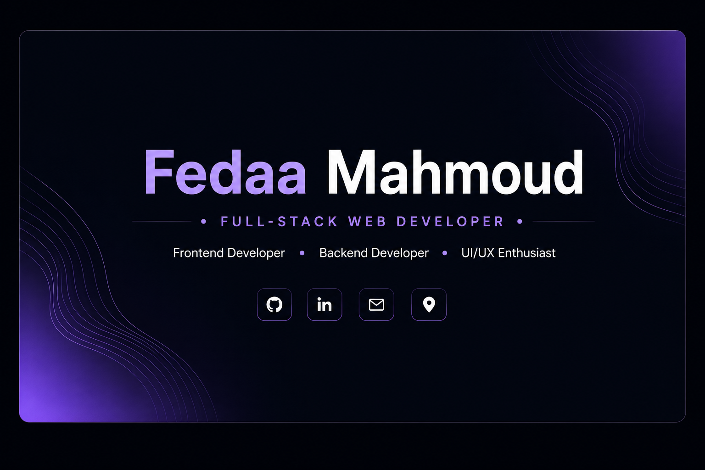

  

Hi, I'm Fedaa Mahmoud 👋
Full-Stack Web Developer | Frontend • Backend • UI/UX
I enjoy building web applications from user-friendly interfaces to the functionality behind them.
I'm always learning, experimenting with new technologies, and turning ideas into projects.

  

👩‍💻 About Me
- 🎓 Computer Science graduate passionate about software development.
- 🌐 Interested in both frontend and backend development and how they work together to create complete web experiences.
- ⚛️ Built frontend projects using HTML, CSS, JavaScript, and React.
- ⚙️ Worked on backend projects using PHP and Laravel.
- 🗄️ Familiar with relational databases, including MySQL.
- 🎨 Have a foundation in UI/UX, with an interest in usability, clear layouts, and user-centered design.
- 🧠 I enjoy learning new tools, solving problems, and improving the way I build and structure projects.
- 🤝 I value collaboration, continuous learning, and writing maintainable code.
🛠️ Tech Stack
Frontend Development

  

Backend Development

  

Tools & Design

  

- **UI/UX:** Fundamentals of user-centered design and usability.

📂 Featured Projects
Project	Description	Focus
LYVRA	Graduation project — a web application built as part of my final-year work.	Web development
CCIC Medical Management System	Medical management system developed during training.	Backend development
Frontend Projects	A collection of interface-focused projects built while practicing frontend development.	HTML, CSS, JavaScript, React

I'll add repository links, screenshots, and setup instructions here as each project is ready to share.

Thanks for visiting my profile! 💜
Keep learning. Keep building. Keep growing.

